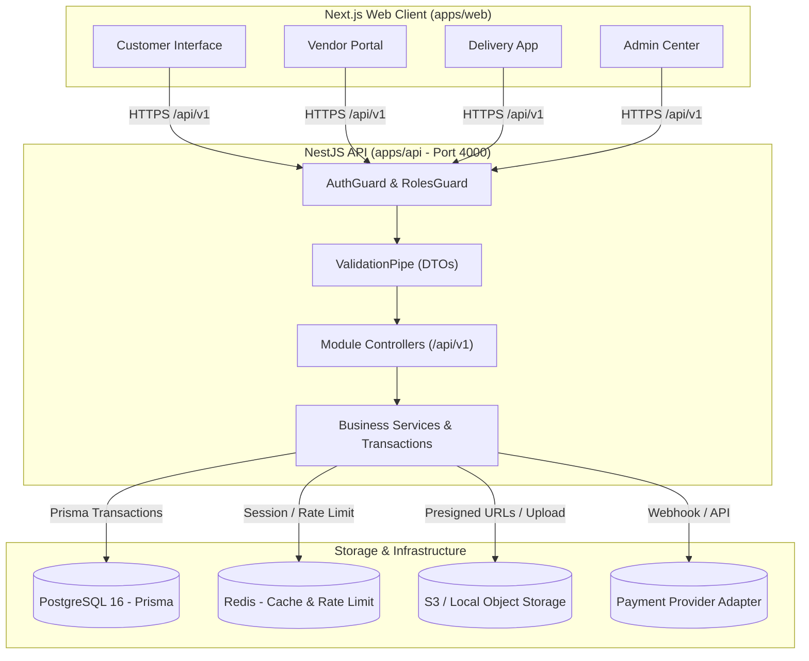

# MarketHub — System Architecture Document
**Project**: MarketHub Multi-Vendor E-Commerce Marketplace  
**Version**: 1.0.0 (Phase 1 Architecture Design)  
**Author**: Senior Software Architect & Security Engineer  

---

## 1. Executive Architecture Summary

MarketHub is an enterprise-grade multi-vendor e-commerce platform designed for horizontal scalability, data isolation, and transactional integrity. Unlike single-vendor shopping carts, MarketHub decouples the customer-facing multi-vendor shopping cart from fulfillment and payout ledgers through a **Parent Order / Vendor Sub-Order Hierarchy**.

### Key Architectural Tenets
1. **Separation of Concerns**: Decoupled NestJS REST backend (`apps/api`) and Next.js 15 App Router frontend (`apps/web`), sharing validation schemas and TypeScript definitions via `packages/shared`.
2. **Zero-Trust Backend**: Client submissions (including prices, discounts, and roles) are never trusted. All totals, taxes, commissions, and authorizations are computed and enforced server-side.
3. **Atomic Multi-Vendor Checkout**: A single customer payment atomically locks inventory, computes parent orders, splits orders by vendor, generates commission snapshots, and assigns delivery tasks.
4. **Resilient Inventory Concurrency**: Utilizes pessimistic row locking (`SELECT ... FOR UPDATE`) and reservation TTLs in PostgreSQL to mathematically prevent overselling under high concurrency.
5. **Pluggable Payment & Storage Abstractions**: Modular adapters allow seamless switching between Mock/Sandbox modes and production providers (Stripe, Razorpay, AWS S3, MinIO, Cloudflare R2).

---

## 2. High-Level Monorepo Topology

```
CODSOFT_TASKNO2/
├── apps/
│   ├── api/                          # NestJS 10.x Enterprise REST API
│   │   ├── src/
│   │   │   ├── common/               # Filters, interceptors, guards, decorators, pipes
│   │   │   │   ├── decorators/       # @CurrentUser, @Roles, @Public
│   │   │   │   ├── filters/          # HttpExceptionFilter, PrismaExceptionFilter
│   │   │   │   ├── guards/           # JwtAuthGuard, RolesGuard, OwnershipGuard
│   │   │   │   ├── interceptors/     # LoggingInterceptor, TransformInterceptor
│   │   │   │   └── pipes/            # ValidationPipe (class-validator)
│   │   │   ├── config/               # Environment configuration and Zod validation
│   │   │   ├── modules/
│   │   │   │   ├── auth/             # JWT, refresh rotation, Argon2/bcrypt password hashing
│   │   │   │   ├── users/            # Customer & staff profiles, address book
│   │   │   │   ├── vendors/          # Store onboarding, approval workflows, KYC
│   │   │   │   ├── categories/       # Hierarchical product taxonomy
│   │   │   │   ├── products/         # Catalog, search, filters, SKU management
│   │   │   │   ├── inventory/        # Stock tracking, movements, reservations, low-stock alerts
│   │   │   │   ├── cart/             # Multi-vendor persistent cart
│   │   │   │   ├── checkout/         # Atomic order splitting, inventory locking, checkout session
│   │   │   │   ├── orders/           # Parent & Vendor order management, state machines
│   │   │   │   ├── payments/         # Payment provider abstraction (Mock, Razorpay, Stripe)
│   │   │   │   ├── commissions/      # Commission engine, vendor earnings, payout ledgers
│   │   │   │   ├── delivery/         # Delivery partner dispatch, status transitions
│   │   │   │   ├── reviews/          # Verified purchase reviews & moderation
│   │   │   │   ├── admin/            # Platform analytics, user moderation, system policies
│   │   │   │   ├── audit-logs/       # Immutable security audit trail
│   │   │   │   ├── storage/          # S3-compatible & Local filesystem upload adapters
│   │   │   │   └── health/           # Liveness/Readiness probes (PostgreSQL, Redis, Storage)
│   │   │   ├── prisma/               # Schema, migrations, seeders
│   │   │   ├── main.ts               # Application bootstrap, Swagger setup, CORS
│   │   │   └── app.module.ts
│   │   ├── test/                     # Unit, Integration, and E2E Jest test suites
│   │   ├── tsconfig.json
│   │   └── package.json
│   │
│   └── web/                          # Next.js 15+ App Router Frontend
│       ├── app/
│       │   ├── (auth)/               # Login, Register, Forgot Password, Vendor Registration
│       │   ├── (customer)/           # Home, Catalog, Product Details, Cart, Checkout, Account
│       │   ├── (vendor)/             # Vendor Dashboard, Products, Inventory, Orders, Earnings
│       │   ├── (delivery)/           # Delivery Partner Portal, Active Jobs, History
│       │   ├── (admin)/              # Admin Control Center, Approvals, Disputes, Analytics
│       │   ├── layout.tsx
│       │   └── globals.css
│       ├── components/               # Reusable UI component library (atomic design)
│       │   ├── ui/                   # Buttons, Inputs, Dialogs, Badges, Tables, Cards
│       │   ├── layout/               # Header, Footer, Sidebar, Navigation
│       │   ├── customer/             # ProductCard, CartDrawer, CheckoutFlow
│       │   ├── vendor/               # ProductForm, StockEditor, OrderStatusUpdater
│       │   └── delivery/             # DeliveryActionCard, StatusStepIndicator
│       ├── lib/                      # API client, auth session helper, formatters (minor units)
│       ├── types/                    # Frontend state interfaces
│       ├── tsconfig.json
│       └── package.json
│
├── packages/
│   └── shared/                       # Shared TypeScript code
│       ├── src/
│       │   ├── constants/            # Role enums, Order statuses, Currency minor units
│       │   ├── dtos/                 # Cross-app DTO contracts
│       │   └── utils/                # Money formatting (Paise to INR), date helpers
│       ├── tsconfig.json
│       └── package.json
│
├── docs/                             # Engineering Documentation
│   ├── architecture.md
│   ├── database-design.md
│   ├── api-overview.md
│   └── security.md
│
├── .env.example                      # Complete environment blueprint
├── .gitignore
├── docker-compose.yml                # Optional local PostgreSQL, Redis, MinIO services
├── package.json                      # Monorepo workspaces config
└── README.md                         # Project documentation and quickstart
```

---

## 3. Communication & Data Flow Diagram



---

## 4. Multi-Vendor Checkout & Order Splitting Engine

When a customer checks out a cart containing items from multiple distinct vendors:

1. **Cart Composition**:
   - `Vendor A`: 2x T-Shirts @ ₹500 = ₹1,000
   - `Vendor B`: 1x Leather Bag @ ₹2,500 = ₹2,500
   - Cart Total: ₹3,500 (350,000 paise)

2. **Atomic Order Generation**:
   - **Parent Order (`Order`)**:
     - `orderNumber`: `MH-2026-1001`
     - `customerId`: `cust_123`
     - `totalAmountMinor`: `350000`
     - `paymentStatus`: `PENDING`
     - `overallStatus`: `PLACED`
   - **Sub-Order 1 (`VendorOrder`)**:
     - `vendorId`: `vendor_A`
     - `subtotalMinor`: `100000`
     - `commissionRateBps`: `1000` (10%)
     - `platformCommissionMinor`: `10000` (₹100)
     - `vendorPayoutMinor`: `90000` (₹900)
     - `status`: `CONFIRMED`
     - Order items: 2x T-Shirts (with SKU and Price snapshot)
   - **Sub-Order 2 (`VendorOrder`)**:
     - `vendorId`: `vendor_B`
     - `subtotalMinor`: `250000`
     - `commissionRateBps`: `1200` (12%)
     - `platformCommissionMinor`: `30000` (₹300)
     - `vendorPayoutMinor`: `220000` (₹2,200)
     - `status`: `CONFIRMED`
     - Order items: 1x Leather Bag (with SKU and Price snapshot)

3. **Data Isolation Invariant**:
   - Vendor A can query and manage ONLY `VendorOrder 1` and its nested items.
   - Vendor B can query and manage ONLY `VendorOrder 2` and its nested items.
   - Delivery partner assigned to VendorOrder 1 sees only pickup from Vendor A and delivery to Customer.
   - Customer sees unified Parent Order MH-2026-1001 with tracking for both sub-shipments.
