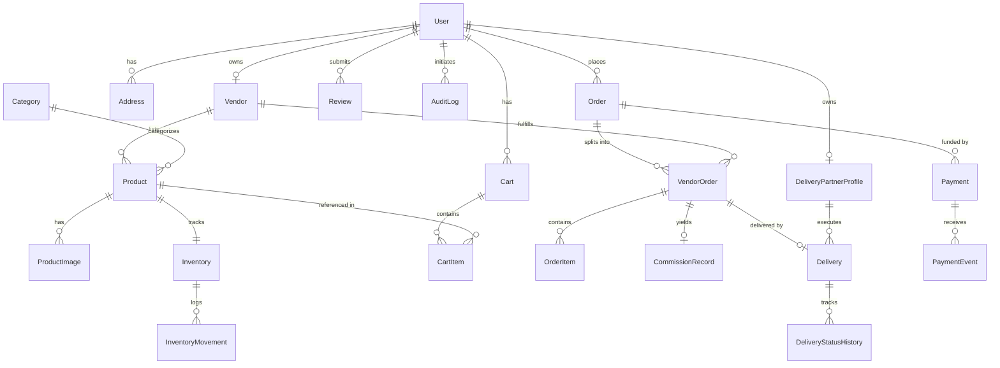

# MarketHub — Database Design & Schema Specification
**Database Engine**: PostgreSQL 16+  
**ORM**: Prisma 5.x / 6.x  
**Financial Standard**: Integer Minor Units (INR Paise: 100 paise = ₹1.00)  

---

## 1. Schema Design Principles

1. **Strict Normalization & Financial Auditability**:
   - Every financial value (`priceMinor`, `subtotalMinor`, `commissionAmountMinor`, `payoutMinor`) is stored as an `Int` or `BigInt` minor unit to eliminate IEEE 754 floating-point rounding errors.
   - Snapshots of product titles, SKUs, and purchase-time prices are stored directly in `order_items`. Subsequent edits to catalog products do not alter historical orders.
2. **Multi-Tenant Vendor Isolation**:
   - Every catalog item, inventory record, and vendor order enforces a foreign key back to `Vendor(id)`.
   - Backend queries mandate `WHERE vendorId = :vendorId` to guarantee tenant isolation.
3. **Pessimistic Concurrency & Stock Locks**:
   - `Inventory` maintains `quantity` (physical stock) and `reservedQuantity` (stock locked in active checkout sessions).
   - Available stock is calculated as: `quantity - reservedQuantity`.
   - Inventory changes are tracked via append-only `inventory_movements`.

---

## 2. Entity-Relationship Overview



---

## 3. Core Models & Definitions

### A. Authentication & Roles
```prisma
enum Role {
  CUSTOMER
  VENDOR
  DELIVERY_PARTNER
  ADMIN
}

enum AccountStatus {
  ACTIVE
  SUSPENDED
  DEACTIVATED
}

model User {
  id            String         @id @default(cuid())
  email         String         @unique
  passwordHash  String
  role          Role           @default(CUSTOMER)
  status        AccountStatus  @default(ACTIVE)
  name          String
  phone         String?
  createdAt     DateTime       @default(now())
  updatedAt     DateTime       @updatedAt

  addresses     Address[]
  vendorProfile Vendor?
  deliveryProfile DeliveryPartnerProfile?
  refreshTokens RefreshToken[]
  orders        Order[]
  reviews       Review[]
  auditLogs     AuditLog[]
  carts         Cart[]

  @@map("users")
}

model RefreshToken {
  id          String    @id @default(cuid())
  userId      String
  user        User      @relation(fields: [userId], references: [id], onDelete: Cascade)
  tokenHash   String    @unique
  expiresAt   DateTime
  revokedAt   DateTime?
  ipAddress   String?
  userAgent   String?
  createdAt   DateTime  @default(now())

  @@index([userId])
  @@map("refresh_tokens")
}

model Address {
  id                String   @id @default(cuid())
  userId            String
  user              User     @relation(fields: [userId], references: [id], onDelete: Cascade)
  recipientName     String
  phone             String
  streetLine1       String
  streetLine2       String?
  city              String
  state             String
  postalCode        String
  country           String   @default("India")
  isDefaultShipping Boolean  @default(false)
  isDefaultBilling  Boolean  @default(false)
  createdAt         DateTime @default(now())
  updatedAt         DateTime @updatedAt

  @@index([userId])
  @@map("addresses")
}
```

### B. Vendor & Delivery Partner Profiles
```prisma
enum VendorStatus {
  PENDING_APPROVAL
  APPROVED
  REJECTED
  SUSPENDED
}

model Vendor {
  id                String       @id @default(cuid())
  userId            String       @unique
  user              User         @relation(fields: [userId], references: [id], onDelete: Cascade)
  storeName         String       @unique
  slug              String       @unique
  description       String?
  logoUrl           String?
  bannerUrl         String?
  status            VendorStatus @default(PENDING_APPROVAL)
  commissionRateBps Int          @default(1000) // 10.00% default commission
  businessEmail     String
  businessPhone     String
  bankAccountNumber String?
  bankIfscCode      String?
  rejectionReason   String?
  createdAt         DateTime     @default(now())
  updatedAt         DateTime     @updatedAt

  products          Product[]
  vendorOrders      VendorOrder[]

  @@map("vendors")
}

enum DeliveryStatusRole {
  AVAILABLE
  BUSY
  OFFLINE
}

model DeliveryPartnerProfile {
  id            String             @id @default(cuid())
  userId        String             @unique
  user          User               @relation(fields: [userId], references: [id], onDelete: Cascade)
  vehicleType   String             // BIKE, VAN, SCOOTER
  licenseNumber String             @unique
  status        DeliveryStatusRole @default(OFFLINE)
  createdAt     DateTime           @default(now())
  updatedAt     DateTime           @updatedAt

  deliveries    Delivery[]

  @@map("delivery_partner_profiles")
}
```

### C. Catalog & Inventory
```prisma
enum ProductStatus {
  DRAFT
  ACTIVE
  ARCHIVED
  SUSPENDED_BY_ADMIN
}

model Category {
  id          String     @id @default(cuid())
  name        String
  slug        String     @unique
  description String?
  imageUrl    String?
  parentId    String?
  parent      Category?  @relation("CategoryHierarchy", fields: [parentId], references: [id], onDelete: SetNull)
  children    Category[] @relation("CategoryHierarchy")
  isActive    Boolean    @default(true)
  createdAt   DateTime   @default(now())
  updatedAt   DateTime   @updatedAt

  products    Product[]

  @@map("categories")
}

model Product {
  id                 String        @id @default(cuid())
  vendorId           String
  vendor             Vendor        @relation(fields: [vendorId], references: [id], onDelete: Cascade)
  categoryId         String
  category           Category      @relation(fields: [categoryId], references: [id], onDelete: Restrict)
  title              String
  slug               String        @unique
  description        String
  priceMinor         Int           // Minor unit (paise)
  compareAtPriceMinor Int?         // Strikethrough price
  sku                String        @unique
  status             ProductStatus @default(DRAFT)
  isFeatured         Boolean       @default(false)
  createdAt          DateTime      @default(now())
  updatedAt          DateTime      @updatedAt

  images             ProductImage[]
  inventory          Inventory?
  cartItems          CartItem[]
  orderItems         OrderItem[]
  reviews            Review[]

  @@index([vendorId])
  @@index([categoryId])
  @@index([status, priceMinor])
  @@map("products")
}

model ProductImage {
  id        String   @id @default(cuid())
  productId String
  product   Product  @relation(fields: [productId], references: [id], onDelete: Cascade)
  url       String
  key       String   // S3 storage object key
  altText   String?
  sortOrder Int      @default(0)
  createdAt DateTime @default(now())

  @@index([productId])
  @@map("product_images")
}

model Inventory {
  id                 String              @id @default(cuid())
  productId          String              @unique
  product            Product             @relation(fields: [productId], references: [id], onDelete: Cascade)
  quantity           Int                 @default(0)
  reservedQuantity   Int                 @default(0)
  lowStockThreshold  Int                 @default(5)
  updatedAt          DateTime            @updatedAt

  movements          InventoryMovement[]

  @@map("inventories")
}

enum InventoryChangeType {
  RESTOCK
  RESERVATION
  SALE
  RELEASE
  ADJUSTMENT
  RETURN
}

model InventoryMovement {
  id            String              @id @default(cuid())
  inventoryId   String
  inventory     Inventory           @relation(fields: [inventoryId], references: [id], onDelete: Cascade)
  changeType    InventoryChangeType
  quantityDelta Int
  balanceAfter  Int
  referenceType String?             // e.g. "CHECKOUT", "ORDER", "MANUAL"
  referenceId   String?
  reason        String?
  createdAt     DateTime            @default(now())

  @@index([inventoryId])
  @@map("inventory_movements")
}
```

### D. Cart, Orders, Splitting & Delivery
```prisma
model Cart {
  id           String     @id @default(cuid())
  userId       String?    @unique
  user         User?      @relation(fields: [userId], references: [id], onDelete: Cascade)
  sessionToken String?    @unique // For anonymous cart fallback
  createdAt    DateTime   @default(now())
  updatedAt    DateTime   @updatedAt

  items        CartItem[]

  @@map("carts")
}

model CartItem {
  id        String   @id @default(cuid())
  cartId    String
  cart      Cart     @relation(fields: [cartId], references: [id], onDelete: Cascade)
  productId String
  product   Product  @relation(fields: [productId], references: [id], onDelete: Cascade)
  quantity  Int      @default(1)
  createdAt DateTime @default(now())
  updatedAt DateTime @updatedAt

  @@unique([cartId, productId])
  @@map("cart_items")
}

enum PaymentStatus {
  PENDING
  PAID
  FAILED
  REFUNDED
}

enum OrderOverallStatus {
  PLACED
  PROCESSING
  PARTIALLY_SHIPPED
  SHIPPED
  DELIVERED
  CANCELLED
}

model Order {
  id                      String             @id @default(cuid())
  orderNumber             String             @unique
  customerId              String
  customer                User               @relation(fields: [customerId], references: [id], onDelete: Restrict)
  shippingAddressSnapshot Json
  billingAddressSnapshot  Json
  totalAmountMinor        Int                // Total order sum
  itemsSubtotalMinor      Int
  shippingFeeMinor        Int                @default(0)
  discountMinor           Int                @default(0)
  paymentStatus           PaymentStatus      @default(PENDING)
  overallStatus           OrderOverallStatus @default(PLACED)
  paymentMethod           String             @default("MOCK_PAYMENT")
  idempotencyKey          String?            @unique
  createdAt               DateTime           @default(now())
  updatedAt               DateTime           @updatedAt

  vendorOrders            VendorOrder[]
  payments                Payment[]

  @@index([customerId])
  @@map("orders")
}

enum VendorOrderStatus {
  PENDING_CONFIRMATION
  CONFIRMED
  PREPARING
  READY_FOR_PICKUP
  PICKED_UP
  IN_TRANSIT
  DELIVERED
  CANCELLED
}

model VendorOrder {
  id                      String            @id @default(cuid())
  subOrderNumber          String            @unique
  orderId                 String
  order                   Order             @relation(fields: [orderId], references: [id], onDelete: Cascade)
  vendorId                String
  vendor                  Vendor            @relation(fields: [vendorId], references: [id], onDelete: Restrict)
  subtotalMinor           Int
  commissionRateBps       Int
  platformCommissionMinor Int
  vendorPayoutMinor       Int
  status                  VendorOrderStatus @default(PENDING_CONFIRMATION)
  createdAt               DateTime          @default(now())
  updatedAt               DateTime          @updatedAt

  items                   OrderItem[]
  delivery                Delivery?
  commissionRecord        CommissionRecord?

  @@index([orderId])
  @@index([vendorId])
  @@map("vendor_orders")
}

model OrderItem {
  id               String      @id @default(cuid())
  vendorOrderId    String
  vendorOrder      VendorOrder @relation(fields: [vendorOrderId], references: [id], onDelete: Cascade)
  productId        String?
  product          Product?    @relation(fields: [productId], references: [id], onDelete: SetNull)
  titleSnapshot    String
  skuSnapshot      String
  unitPriceMinor   Int
  quantity         Int
  totalPriceMinor  Int
  createdAt        DateTime    @default(now())

  reviews          Review[]

  @@index([vendorOrderId])
  @@map("order_items")
}

enum DeliveryState {
  PENDING_ASSIGNMENT
  ASSIGNED
  PICKED_UP
  IN_TRANSIT
  OUT_FOR_DELIVERY
  DELIVERED
  FAILED_ATTEMPT
  CANCELLED
}

model Delivery {
  id                String                 @id @default(cuid())
  vendorOrderId     String                 @unique
  vendorOrder       VendorOrder            @relation(fields: [vendorOrderId], references: [id], onDelete: Cascade)
  deliveryPartnerId String?
  deliveryPartner   DeliveryPartnerProfile? @relation(fields: [deliveryPartnerId], references: [id], onDelete: SetNull)
  trackingCode      String                 @unique
  status            DeliveryState          @default(PENDING_ASSIGNMENT)
  recipientName     String
  deliveryAddress   String
  recipientPhone    String
  pickupTimestamp   DateTime?
  deliveredTimestamp DateTime?
  failureReason     String?
  createdAt         DateTime               @default(now())
  updatedAt         DateTime               @updatedAt

  history           DeliveryStatusHistory[]

  @@index([deliveryPartnerId])
  @@map("deliveries")
}

model DeliveryStatusHistory {
  id          String        @id @default(cuid())
  deliveryId  String
  delivery    Delivery      @relation(fields: [deliveryId], references: [id], onDelete: Cascade)
  status      DeliveryState
  note        String?
  createdAt   DateTime      @default(now())

  @@index([deliveryId])
  @@map("delivery_status_histories")
}

model CommissionRecord {
  id                    String      @id @default(cuid())
  vendorOrderId         String      @unique
  vendorOrder           VendorOrder @relation(fields: [vendorOrderId], references: [id], onDelete: Cascade)
  grossAmountMinor      Int
  commissionRateBps     Int
  commissionAmountMinor Int
  netVendorAmountMinor  Int
  isSettled             Boolean     @default(false)
  settledAt             DateTime?
  createdAt             DateTime    @default(now())

  @@map("commission_records")
}

model Payment {
  id                 String        @id @default(cuid())
  orderId            String
  order              Order         @relation(fields: [orderId], references: [id], onDelete: Cascade)
  provider           String        // MOCK, RAZORPAY, STRIPE
  providerPaymentId  String?       @unique
  providerSignature  String?
  amountMinor        Int
  currency           String        @default("INR")
  status             PaymentStatus @default(PENDING)
  failureReason      String?
  createdAt          DateTime      @default(now())
  updatedAt          DateTime      @updatedAt

  events             PaymentEvent[]

  @@index([orderId])
  @@map("payments")
}

model PaymentEvent {
  id          String   @id @default(cuid())
  paymentId   String
  payment     Payment  @relation(fields: [paymentId], references: [id], onDelete: Cascade)
  eventId     String   @unique
  eventType   String
  payload     Json
  processedAt DateTime @default(now())

  @@map("payment_events")
}

model Review {
  id                  String     @id @default(cuid())
  productId           String
  product             Product    @relation(fields: [productId], references: [id], onDelete: Cascade)
  customerId          String
  customer            User       @relation(fields: [customerId], references: [id], onDelete: Cascade)
  orderItemId         String?
  orderItem           OrderItem? @relation(fields: [orderItemId], references: [id], onDelete: SetNull)
  rating              Int        // 1 to 5
  comment             String
  isVerifiedPurchase  Boolean    @default(true)
  isApproved          Boolean    @default(true)
  createdAt           DateTime   @default(now())

  @@unique([productId, customerId])
  @@map("reviews")
}

model AuditLog {
  id         String   @id @default(cuid())
  actorId    String?
  user       User?    @relation(fields: [actorId], references: [id], onDelete: SetNull)
  actorRole  Role?
  action     String   // VENDOR_APPROVAL, COMMISSION_CHANGE, STATUS_OVERRIDE
  entityName String   // Vendor, Order, Product
  entityId   String
  ipAddress  String?
  userAgent  String?
  metadata   Json?
  createdAt  DateTime @default(now())

  @@index([entityName, entityId])
  @@map("audit_logs")
}
```
